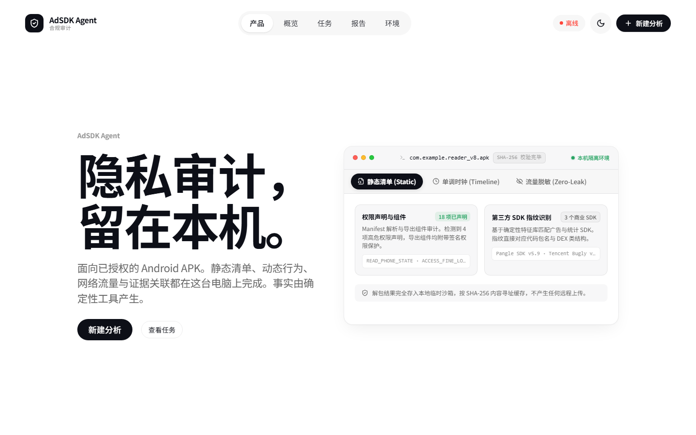

# AdSDK Agent

> **面向 Android APK 的本地隐私合规审计与取证分析平台。**  
> 坚持“隐私审计留在本机”与“证据先于叙述”，通过现代化的 Web 审计工作台，提供 APK 静态清单提取、动态行为拦截、网络流量观测、单调时钟 Consent 阶段划分、确定性证据关联、隐私风险发现与 AI 辅助研判。



> [!IMPORTANT]
> **合规使用与职责边界声明**：  
>
> 1. 本项目仅用于**已获得合法授权**的 APK 测试、隐私合规审计与安全性研究，严禁用于未授权目标。  
> 2. **事实由确定性工具产生**：所有计数、敏感行为拦截、网络请求与规则判定均由本地沙箱与确定性引擎生成。AI 仅在用户显式启用后，负责受白名单约束的工具编排与报告叙述润色，不得虚构证据或推翻技术事实。

---

## 核心设计哲学

- **隐私审计，留在本机**：所有 APK 文件解包、Frida 动态插桩、网络外发流量抓取与证据关联均在本地机器闭环完成，原始文件与真实敏感标识绝不上云。
- **证据先于叙述**：确定性规则引擎给出客观技术事实、疑似风险与证据缺口；模型不能修改其中的计数、风险分值或证据引用。
- **同意，用时间划分**：采用单调时钟（Monotonic Clock）精确界定“同意前”（`pre_consent`）、“同意后”（`post_consent`）与“时间不明”（`unknown`），绝不依赖不可靠的界面文案顺序进行主观猜测。
- **看见请求，不留下秘密**：严格执行网络流量最小化与 Zero-Leak 脱敏机制，仅记录主机与路径形态，绝不保存 Cookie、认证头或请求/响应正文。
- **未观察到，不是安全；时间接近，不是因果**：
  - 观察窗口内零请求仅代表未观测到外发，不代表应用不会联网。
  - 动态行为与网络请求的关联仅证明“时间接近”，不主观妄断存在确定因果。
- **真机安全信封**：在操作设备前必须经过设备确认门（Confirmation Gate），具备设备排他租约、资源所有权跟踪、Consent 人工检查点、`try/finally` 强制清理与网络代理自动恢复机制。

---

## 前端页面全景

| 页面 | 访问路径 | 核心功能与审计职责 |
| :--- | :--- | :--- |
| **产品首页** | `/` | 愿景陈述、01~05 取证流水线、规格说明、Hero 交互演示 |
| **概览仪表盘** | `/dashboard` | 全局分析态势、四类任务指标监控、快速发起与最近任务 |
| **新建分析** | `/analysis/new` | 四种分析模式切换、APK 路径校验、设备选择与参数配置 |
| **任务中心** | `/tasks` | 持久化任务列表、多维状态/类型/风险筛选、分页搜索 |
| **任务详情** | `/tasks/:id` | 取证步骤推进链、Consent 检查点交互、日志流与产物 |
| **静态分析** | `/static` | APK 清单、组件与导出服务审计、危险权限与 SDK 指纹 |
| **动态分析** | `/dynamic` | Frida 分层诊断、A/B/C/D 证据质量、单调时钟行为轴 |
| **流量观测** | `/traffic` | mitmproxy 会话、Zero-Leak 脱敏请求抽屉与主机统计 |
| **版本对比** | `/comparisons` | 新旧版本 APK 权限、SDK、敏感行为与流量差异横向比对 |
| **报告中心** | `/reports` | 规则判定卡片、隐私发现、证据关联、AI 研判与多格式导出 |
| **环境检测** | `/environment` | ADB、Frida 运行时、mitmdump、后端连接四态就绪检查 |
| **系统设置** | `/settings` | AI Provider 配置、DPAPI 硬件级本地加密、预算限制 |

---

## 系统架构与技术栈

```text
┌─────────────────────────────────────────────────────────────────────────────┐
│                        React 18 Web Console (Vite 6)                        │
│   Home · Dashboard · NewAnalysis · Tasks · Static · Dynamic · Traffic       │
│           Reports · Comparisons · Environment · Settings · SiteNav          │
└──────────────────────────────────────┬──────────────────────────────────────┘
                                       │ HTTP / REST / WebSocket
┌──────────────────────────────────────▼──────────────────────────────────────┐
│                            FastAPI Local Engine                             │
│ ┌──────────────────────┐ ┌──────────────────────┐ ┌───────────────────────┐ │
│ │     Task Center      │ │   Analyzers Engine   │ │     AI Controller     │ │
│ │ SQLite / State / Log │ │ Manifest / Risk / SDK│ │ Whitelist Tools / DAG │ │
│ │ Progress / Cleanup   │ │ Monotonic Consent    │ │ Evidence Digest / TTL │ │
│ │ Retry / Cancellation │ │ Correlation-v1       │ │ DPAPI Secret Storage  │ │
│ └──────────────────────┘ └──────────────────────┘ └───────────────────────┘ │
└──────────────────────┬───────────────────────────────┬──────────────────────┘
                       │                               │
  ┌────────────────────▼───────────┐      ┌────────────▼──────────────────┐
  │         Android Device         │      │     Local State & Artifacts   │
  │  ADB Sessions · Frida 17 Agent │      │  SQLite Database (WAL Mode)   │
  │  mitmproxy Zero-Leak Proxy     │      │  SHA-256 Unpack Cache         │
  │  Monotonic Timing Baseline     │      │  output/runs/ Evidence Archive│
  └────────────────────────────────┘      └───────────────────────────────┘
```

### 技术栈一览

| 层次 | 技术选型 | 说明 |
| :--- | :--- | :--- |
| **前端框架** | React 18、TypeScript、Vite 6 | 严谨强类型组件化，支持全站路由代码分割与懒加载 |
| **样式与交互** | Tailwind CSS、Framer Motion | 精细化 CSS Tokens 设计系统、流体微交互与按压动效 |
| **状态与请求** | TanStack Query v5、Zustand | 服务端数据缓存、自愈轮询、主题切换与活跃分析状态管理 |
| **前端质量** | Vitest、Testing Library、MSW | 31 个测试套件，337 项用例全部通过，覆盖空态与错误边界 |
| **后端核心** | Python 3.12+、FastAPI、Pydantic v2 | 高性能异步 API，严格输入校验与强类型响应契约 |
| **底层工具链** | apktool、ADB、Frida 17、mitmproxy | 离线静态解包、设备交互、底层 API Hook、受控流量镜像 |
| **数据与安全** | SQLite (WAL 模式)、Windows DPAPI | 单机任务状态持久化、本地机器级别加密保护 AI API 密钥 |
| **后端质量** | pytest、httpx | 776 项自动化测试通过，涵盖单元、链路、降级与真实回放 |

---

## 核心功能详解

### 1. 任务中心与多格式报告
- **持久化任务体系**：分析任务提交后由后台线程池执行，状态、进度与取证步骤持久化记录于 SQLite（`output/state/adsdk-agent.db`）。
- **实时通信与自愈**：通过 WebSocket 实时订阅任务推进；若网络中断，前端自动无缝降级为 HTTP 定时轮询，重连后恢复推送。
- **全生命周期管控**：支持排队中/运行中任务的安全取消（带 `finally` 资源清理）、失败重试、任务软删除，并只读兼容旧版浏览器历史记录。
- **合规报告导出**：支持一键导出包含完备证据快照的 JSON 结构化数据、Markdown 专业归档文档以及自包含样式的独立 HTML 报告。

### 2. 静态分析与解包缓存
- **APK 快照防护**：严格限制 APK 仅能读取自允许白名单目录（默认 `samples/`），执行路径穿越防御与 ZIP 结构校验，并在创建任务时生成原子快照，按 SHA-256 二次复核防篡改。
- **解包性能优化**：建立基于 SHA-256 的解包文件缓存（`output/cache/static-unpack/<SHA256>/`），避免重复调用 apktool，显著缩短二次审计等待时间。
- **深度配置审计**：自动解析 `AndroidManifest.xml`、包信息、四级敏感权限分类（普通/危险/签名/系统）、组件导出安全性，并匹配商业广告、统计分析、推送定位等知名第三方 SDK 指纹。

### 3. 动态行为取证与 Frida 17 可靠性
- **Frida 17 架构适配**：针对 Frida 17 不再内置 Java Bridge 的底层机制，采用专用打包脚本预编译离线 `frida-java-bridge` Agent，支持完全离线加载，不依赖外部网络拉取依赖。
- **三级 Hook 策略**：
  - `strict`（严格）：强制在进程启动前执行 `spawn_suspended`，注入失败即停止，确保捕捉最早期冷启动调用。
  - `balanced`（平衡，默认推荐）：优先尝试启动前 Hook，当检测到兼容性异常时，自动清理并安全降级为 `launch_then_attach`。
  - `attach_only`（仅附加）：仅附加已在运行的宿主进程，适用于排查应用热运行期的 API 调用。
- **A/B/C/D 证据等级与崩溃识别**：
  - 自动输出证据质量评级，明确标注观察窗口覆盖范围与置信度。
  - 针对 MuMu 模拟器（x86_64）运行 ARM64 翻译时可能出现的指令兼容性问题，自动识别并标记 `native_bridge_compatibility_suspected`，避免误报为应用反调试。
  - 外部预先启动的 `frida-server` 属于系统所有，任务结束时不予盲目停止，防止污染宿主环境。

### 4. 网络流量捕获与 Zero-Leak 隐私保护
- **独立代理沙箱**：为每个任务分配唯一的 `MitmSession` 实例与独立端口租约（默认 8080~8090 端口池），采集完毕自动释放。
- **网络状态明确分级**：系统严格区分三种网络采集结局：
  1. `collector_failed`：采集器未能正常就绪；
  2. `collector_success_zero_requests`：采集器成功运行，但在观察窗口内未产生流量（可能为无网络需求、证书 Pinning 拒绝或直接绕过系统代理）；
  3. `collector_success_requests_observed`：成功观测到外发请求。
- **Zero-Leak 隐私脱敏**：绝不保留或持久化 Authorization 头、Cookie、请求和响应的正文，query 参数值默认脱敏处理，防止敏感通信凭据在审计过程中产生二次泄露。

### 5. 单调时钟 Consent 检查点
- **拒绝文案猜想**：坚决摒弃靠 UI 文本树顺序推测用户同意状态的不可靠方式。
- **单调时钟硬判定**：
  ```text
  事件发生时戳 < 同意检查点时戳  ──> pre_consent  (同意前违规调用，高风险)
  事件发生时戳 >= 同意检查点时戳 ──> post_consent (同意后正常调用)
  时钟数据缺失或无效             ──> unknown      (时间不明，规则记为未评估)
  ```
- **人工干预检查点**：任务执行到预置阶段时，向控制台发出 Consent 检查点通知，由合规审计员在设备上手动点击授权后回传确认（`confirmed` / `not_found` / `skipped`），确保取证切片绝对真实。

### 6. 证据关联引擎与隐私发现分类
- **时间接近关联 (`correlation-v1`)**：在默认 2500ms 的可信时间窗口内，将敏感 API 行为（如读取设备 ID、位置）与就近发生的外发网络请求进行关联。仅表达时间维度的高概率接近，克制地不给出“必然是该 API 导致了该请求”的因果判定。
- **隐私发现三态模型 (`privacy-findings-v2`)**：
  - **`observed` (技术事实)**：已通过底层监控确认发生的技术客观事实（如：在同意前调用了 `getDeviceId()`）。
  - **`suspected` (疑似风险)**：依据合规基线研判出的潜在风险条目。
  - **`evidence_gap` (证据缺口)**：由于证书锁定、网络无响应或环境受限导致当前证据不足以支撑裁决的缺口记录。

### 7. 受控 AI 辅助研判与安全信封
- **白名单工具与两阶段调用**：模型只能使用已在本地白名单注册的只读工具，按“规划阶段”（生成执行 DAG）和“报告阶段”（整合 Markdown 总结）分阶段受控调用，禁止执行任意系统命令。
- **Evidence Digest 语义压缩**：向模型注入的不是全量原始数据，而是高度提炼、结构稳定的 `evidence-digest-v1` 摘要，有效节约 Token 消耗并防御 Prompt 注入。
- **硬件级本地密钥安全**：
  - 在 Windows 平台上，用户配置的 API Key 经操作系统底层 **DPAPI（Data Protection API）** 强加密后存储（`output/config/ai-secret.bin`）。
  - 前端读取设置时永不回传 Key 原文，任务结束或关闭页面后前端自动清除敏感内存，防止密钥通过日志或状态外泄。
- **主流大模型兼容**：完美支持标准 OpenAI 兼容接口，内置 DeepSeek Profile 模式（自动处理 DeepSeek 的输出格式并适配思考模式），具备 JSON 骨架硬约束与确定性自愈重试能力。

---

## 快速开始

### 1. 环境准备

确保本机已安装以下基础工具并已加入系统 `PATH`：
- **Python** 3.12+（推荐 3.12 或 3.14）
- **Node.js** 18+ 与 npm
- **Android SDK Platform-Tools**（`adb`）
- **apktool** 2.9+
- **Java Runtime Environment (JRE)** 17+（apktool 运行所需）

验证工具环境可用：
```bash
adb version
apktool --version
node -v
npm -v
```

### 2. 获取代码与依赖安装

```powershell
# 克隆代码库
git clone <your-repository-url>
cd adsdk-agent

# 配置 Python 虚拟环境与依赖
py -m venv .venv
.venv\Scripts\Activate.ps1
python -m pip install --upgrade pip
python -m pip install -r requirements.txt

# 准备环境变量
Copy-Item .env.example .env

# 安装前端依赖
cd web
npm install
cd ..
```

> [!CAUTION]
> 部署使用前，请务必在根目录 `.env` 文件中修改 `REDACTION_HMAC_KEY`，替换为一个随机强密钥字符串，以保证脱敏哈希的私密性。

### 3. 一键启动服务

AdSDK Agent 提供了完备的自动化脚本，双击或在终端中运行：

```powershell
# Windows 批处理一键启动
.\start-adsdk-agent.bat

# 或通过 PowerShell 运行
.\start-adsdk-agent.ps1
```

启动脚本将自动检测环境、启动 FastAPI 后端（端口 8000）并拉起 Vite 前端开发服务器（端口 5173），就绪后自动在浏览器中打开：

- **Web 审计控制台**：[http://127.0.0.1:5173](http://127.0.0.1:5173)
- **后端 API 服务**：[http://127.0.0.1:8000](http://127.0.0.1:8000)
- **交互式 API 文档 (Swagger)**：[http://127.0.0.1:8000/docs](http://127.0.0.1:8000/docs)

停止服务只需执行：
```powershell
.\stop-adsdk-agent.bat
```
脚本将优雅终止所启动的前后端子进程，并自动清理运行时进程锁。

### 4. 手动启动模式

若需独立调试前后端：

```powershell
# 终端 1：启动后端
.venv\Scripts\Activate.ps1
python -m uvicorn app.main:app --host 127.0.0.1 --port 8000 --reload

# 终端 2：启动前端
cd web
npm run dev
```

---

## 典型审计流程

```text
                 ┌────────────────┐
                 │  01. 环境检测  │ 确认 ADB、设备连接、Frida 及 mitmproxy 正常
                 └───────┬────────┘
                         ▼
                 ┌────────────────┐
                 │  02. 新建分析  │ 放置 APK 至 samples/，选择分析模式与参数
                 └───────┬────────┘
                         ▼
        ┌────────────────┴────────────────┐
        ▼                                 ▼
┌────────────────┐               ┌────────────────┐
│    静态模式    │               │    动态模式    │
│  - 安全解包    │               │  - 进程监控    │
│  - 清单组件    │               │  - 授权检查    │ 手动完成设备交互
│  - 指纹识别    │               │  - 流量抓取    │
└────────────────┘               └────────────────┘
        │                                 │
        └────────────────┬────────────────┘
                         ▼
                 ┌────────────────┐
                 │  03. 关联分析  │ 运行 correlation-v1 关联行为与流量
                 └───────┬────────┘
                         ▼
                 ┌────────────────┐
                 │  04. 隐私发现  │ 汇总 observed / suspected / evidence_gap
                 └───────┬────────┘
                         ▼
                 ┌────────────────┐
                 │  05. 报告研判  │ 确定性规则评估 + 可选 AI 叙述，导出 HTML/JSON
                 └────────────────┘
```

---

## 核心配置项参考

全部配置项均可在根目录 `.env` 中按需定制，详见 [`.env.example`](.env.example)：

### 采集与检测参数
| 配置项 | 默认值 | 作用说明 |
| :--- | :--- | :--- |
| `APK_ALLOWED_ROOTS` | `samples` | 允许审计的 APK 存放根目录，杜绝越权读取 |
| `APK_MAX_SIZE_MB` | `1024` | 允许分析的 APK 文件体积上限（MB） |
| `REDACTION_HMAC_KEY` | *(开发占位密钥)* | 敏感数据 HMAC 脱敏计算密钥（生产必须修改） |
| `FRIDA_READY_TIMEOUT_SECONDS` | `15` | Frida 探针注入并就绪的等待超时（秒） |
| `FRIDA_SPAWN_STABILITY_SECONDS` | `3` | 进程恢复（resume）后的稳定观察窗口（秒） |
| `MITM_PORT_START / END` | `8080 / 8090` | mitmproxy 动态代理端口分配池 |
| `EVIDENCE_CORRELATION_WINDOW_MS` | `2500` | 行为与请求关联的默认时间窗口大小（毫秒） |

### AI 编排参数
| 配置项 | 默认值 | 作用说明 |
| :--- | :--- | :--- |
| `AI_ENABLED` | `false` | AI 编排研判总开关（默认关闭） |
| `AI_PROVIDER_PROFILE` | `auto` | 供应商模式：`auto` / `generic_openai` / `deepseek` |
| `AI_BASE_URL` | *(空)* | OpenAI-Compatible API 基础接入点 |
| `AI_MODEL` | *(空)* | 调用的大语言模型名称 |
| `AI_MAX_ROUNDS` | `2` | 单次任务允许的大模型交互轮数上限 |
| `AI_MAX_INPUT_TOKENS` | `6000` | 单次调用允许输入的最大 Token 预算 |
| `AI_MAX_OUTPUT_TOKENS` | `1800` | 单次调用输出的最大 Token 预算 |
| `AI_CACHE_ENABLED` | `true` | 是否对完全一致的 Evidence Digest 启用缓存 |

---

## 输出产物说明

每次任务运行都会在 `output/runs/<run_id>/` 下生成完全自包含的证据与报告归档：

```text
output/runs/<run_id>/
├── input/app.apk                 # 审计目标 APK 快照备份
├── unpacked/                     # apktool 静态解包内容
├── hook.log                      # Frida 探针运行日志
├── events.json                   # 结构化敏感 API 调用事件列表
├── traffic/
│   ├── flows.mitm                # mitmproxy 二进制流量快照
│   ├── requests.jsonl            # 已脱敏的 HTTP 请求记录行
│   └── mitm.stderr.log           # 抓包服务日志
├── traffic_summary.json          # 流量采集统计摘要
├── correlations.json             # 行为—流量证据关联集 (correlation-v1)
├── privacy-findings.json         # 隐私发现清单 (privacy-findings-v2)
├── ai-plan.json                  # AI 规划生成的步骤 DAG (若启用 AI)
├── evidence-digest.json          # 传入模型的紧凑型证据摘要
├── ai-report.json                # AI 生成的合规研判与叙述
├── report.json                   # 综合合规审计全量数据快照
├── report.md                     # Markdown 格式审计报告
└── report.html                   # 自包含样式的现代化 HTML 交互报告
```

---

## 测试与代码质量

项目遵循严格的工程化验证标准，所有主要功能均有完备的自动化测试守护：

```powershell
# 运行后端全量测试套件 (pytest)
.venv\Scripts\python.exe -m pytest -q
# 输出结果：776 passed

# 运行前端全量测试套件 (vitest)
cd web
npm test -- --run
# 输出结果：31 test files / 337 passed

# 运行前端类型检查与生产构建
npm run typecheck
npm run build
```

---

## 目录结构索引

```text
adsdk-agent/
├── app/                          # 后端核心应用模块
│   ├── ai/                       # AI 编排器、工具注册中心、Digest 压缩与配置
│   ├── analyzers/                # Manifest、SDK 指纹、关联算法与隐私发现引擎
│   ├── comparisons/              # APK 版本比对分析器
│   ├── core/                     # 快照、解包缓存、路径安全与 HMAC 脱敏
│   ├── frida/                    # Frida 诊断、会话控制与 Native Bridge 兼容适配
│   ├── orchestration/            # 确认门、排他租约、Consent 检查点与清理管理
│   ├── repositories/             # SQLite 任务与步骤持久化仓储
│   ├── reporting/                # HTML / Markdown 报告生成器
│   └── main.py                   # FastAPI 应用入口与路由分发
├── web/                          # 前端工程 (React 18 + Vite 6 + TypeScript)
│   ├── src/
│   │   ├── api/                  # 强类型后端 API 交互封装
│   │   ├── components/           # 页面部件 (Home、Analysis、Report、Layout、Traffic 等)
│   │   ├── pages/                # 11 个独立业务工作台页面组件
│   │   ├── router/               # 路由表定义
│   │   ├── stores/               # Zustand 响应式状态管理
│   │   ├── tokens.css            # 设计令牌 (颜色、边距、阴影、层级)
│   │   └── index.css             # 基础排版、胶囊组件与动效样式
│   └── package.json
├── docs/                         # 产品设计、可靠性分析与真机验收归档
├── samples/                      # 待测 APK 安全存放目录
├── scripts/                      # 离线 Frida Agent 预构建脚本
├── tests/                        # 后端自动化测试套件
├── .env.example                  # 环境变量配置模板
├── requirements.txt              # 后端 Python 依赖清单
├── start-adsdk-agent.bat         # Windows 一键启动脚本
└── stop-adsdk-agent.bat          # Windows 一键停止脚本
```

---

## 许可证

本项目采用 [Apache License 2.0](LICENSE) 开源许可证。
